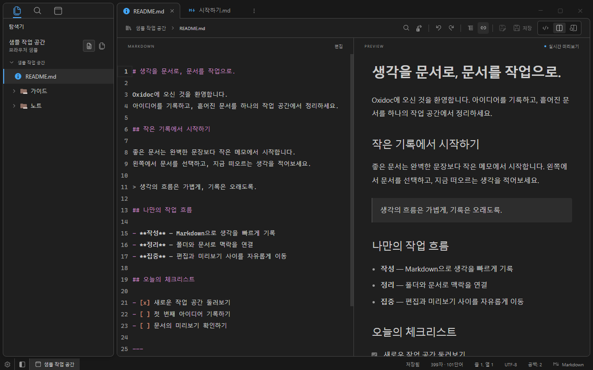
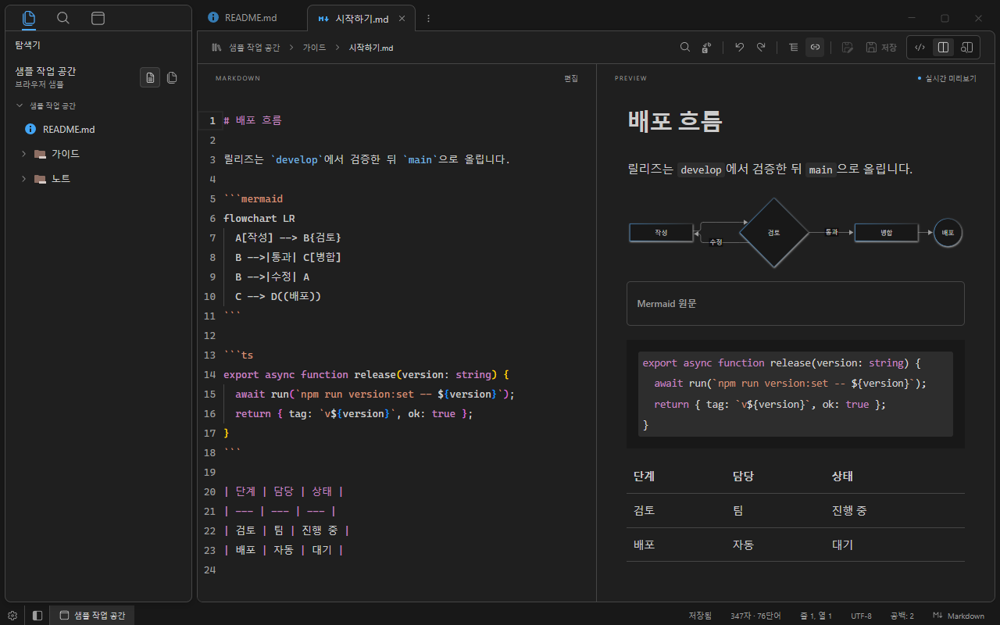
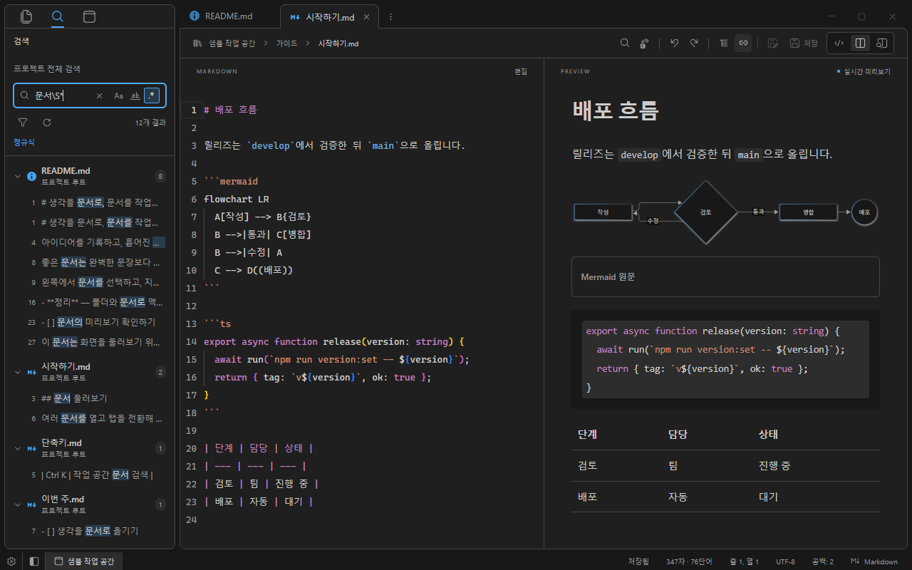
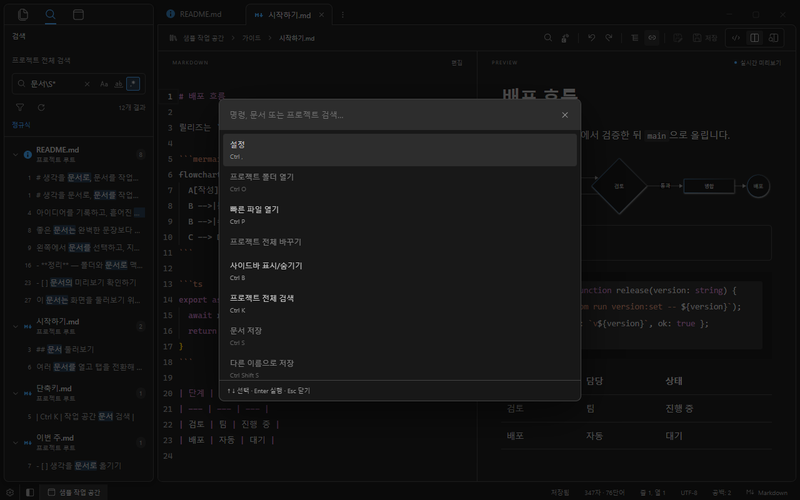
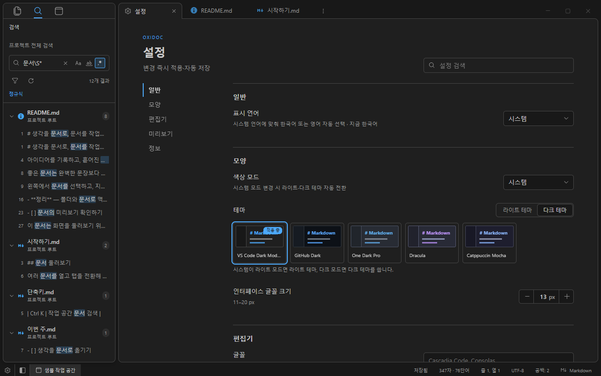
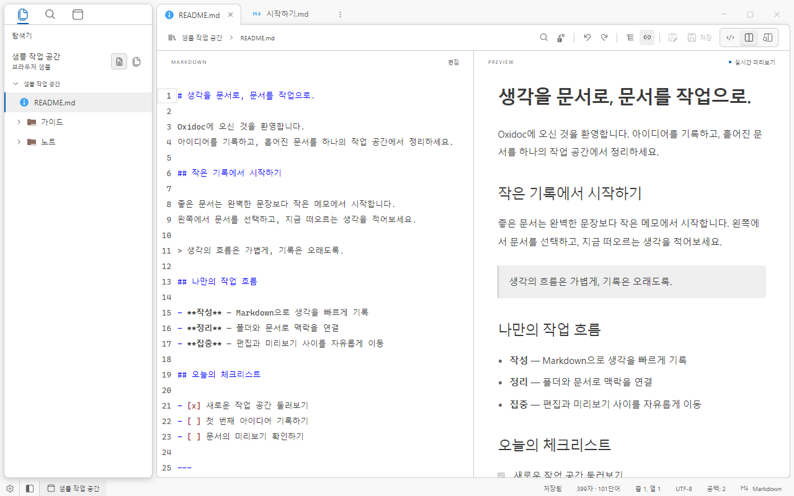

  
  <h1>Oxidoc</h1>
  
내 폴더의 Markdown 문서를 VS Code처럼 다루는 Windows 데스크톱 에디터

  
  

---

## 주요 기능

- **프로젝트 폴더 그대로** — 이미 있는 폴더를 프로젝트로 등록해 즐겨찾기·태그·최근 사용순으로 전환한다. 문서는 원래 파일로만 저장된다.
- **프로젝트 탭** — 여러 프로젝트를 상태 표시줄 탭으로 열어 두고, 저장하지 않은 편집을 그대로 둔 채 오간다. 프로젝트 밖 문서는 등록 없이 `External` 탭에서 연다.
- **편집과 미리보기** — Monaco 편집기와 실시간 미리보기를 나란히 두고 스크롤을 맞춘다. 문서 개요, 코드 블록 구문 강조, 표·체크리스트, 허용된 HTML(`
`·`<kbd>` 등)을 지원한다.
- **Mermaid 다이어그램** — 코드 블록과 `.mmd`·`.mermaid` 파일을 그림으로 보여 준다.
- **탐색기** — 생성·이름 변경·휴지통 이동·복사·잘라내기·끌어서 이동. 파일을 옮기거나 이름을 바꾸면 다른 문서의 링크도 함께 고칠 수 있다.
- **이미지** — 붙여넣은 이미지를 `assets`에 저장하고 링크를 넣는다. 이미지 파일은 탭에서 휠 확대·끌어서 이동으로 본다.
- **검색과 바꾸기** — 프로젝트 전체를 정규식·단어 단위·포함/제외 파일 조건으로 찾고, 바꾸기 전에 파일별 변경을 미리 본다. 빠른 파일 열기와 명령 팔레트도 있다.
- **링크 도우미** — 문서 경로·제목 자동 완성, 깨진 링크와 앵커 경고.
- **안전한 저장** — 외부 변경 감지, 저장하지 않은 문서 복구, 다시 열 때 탭과 화면 배치 복원.
- **설정** — 한국어/English, 라이트·다크 테마 각 5종, 글꼴·글꼴 크기·줄 바꿈, 설치된 글꼴 검색, 앱 안에서 업데이트.

세부 동작·단축키·제한 값은 [화면과 기능](docs/plan/UI.md)에 있다.

## 화면

스크린샷은 브라우저 미리보기의 샘플 작업 공간으로 찍었다.

### 편집과 미리보기

왼쪽 탐색기, 가운데 편집기, 오른쪽 미리보기. 보기 버튼으로 편집·분할·미리보기를 바꾼다.

  

### Mermaid·코드·표

Mermaid 코드 블록은 다이어그램으로, 언어를 적은 코드 블록은 편집기와 같은 색으로 강조한다.

  

### 프로젝트 검색

대소문자·단어 단위·정규식 토글과 파일 조건으로 찾고, 결과는 파일별로 묶어 보여 준다.

  

### 명령 팔레트

`Ctrl Shift P`로 명령·문서·프로젝트를 찾아 실행한다.

  

### 설정

섹션 목록과 설정 검색으로 항목을 찾고, 바꾼 값은 바로 적용·저장된다.

  

### 라이트 테마

시스템 모드에 맞춰 라이트·다크 테마가 바뀐다.

  

## 시작하기

1. [최신 릴리즈](https://github.com/DevPumpkin0113/oxidoc/releases/latest)에서 `Oxidoc_*_x64-setup.exe`를 받아 설치한다. 이후 버전은 앱 안에서 업데이트된다.
2. **프로젝트 등록**으로 Markdown 문서가 있는 폴더를 고른다.
3. 탐색기에서 문서를 열어 편집하고 `Ctrl S`로 저장한다.

Windows에서 `.md` 파일의 기본 프로그램을 Oxidoc으로 지정하면 파일을 더블클릭해 그 문서가 속한 프로젝트로 바로 열 수 있다. 등록한 폴더 밖의 파일은 `External`에 모여 열린다. 상태 표시줄의 프로젝트 탭으로 여러 프로젝트와 External을 저장하지 않은 편집까지 그대로 둔 채 오갈 수 있다.

코드 서명이 없어 처음 실행할 때 Windows SmartScreen 경고가 나올 수 있다.

## 내 파일과 앱 데이터

- 문서·이미지는 등록한 폴더의 실제 파일이다. 앱은 별도 형식으로 바꾸거나 복사하지 않으므로 Git으로 관리할 수 있다.
- 프로젝트 목록·설정·열린 탭·저장하지 않은 문서의 복구본은 `%APPDATA%\com.oxidoc.desktop\`에 둔다.
- 앱은 등록한 폴더 안의 파일만 읽고 쓴다. 미리보기는 스크립트를 차단하고, 원격 이미지는 VS Code처럼 https만 불러온다(설정에서 끌 수 있음).

계정·동기화·실시간 협업은 지원하지 않는다.

## 문제 제보

버그와 제안은 [GitHub Issues](https://github.com/DevPumpkin0113/oxidoc/issues)에 남긴다. 버전, 재현 순서, 오류 메시지를 함께 적고, 스크린샷의 개인 정보와 민감한 문서 내용은 지운다.

변경 내용은 [변경 이력](CHANGELOG.md)에서 볼 수 있다.

## 개발

빌드·테스트·폴더 구성은 [개발 안내](docs/DEVELOPMENT.md)에 있다.

## 고지

- UI·창 제어 아이콘: [VS Code Codicons](https://github.com/microsoft/vscode-codicons) — [라이선스](public/licenses/codicons-LICENSE.txt), [코드 라이선스](public/licenses/codicons-LICENSE-CODE.txt)
- 파일·폴더 아이콘: [Material Icon Theme](https://github.com/material-extensions/vscode-material-icon-theme) — [라이선스](public/licenses/material-icon-theme-LICENSE.txt)
- 편집기: Monaco 및 전용 Codicon 폰트 — [라이선스](public/licenses/monaco-LICENSE.txt), [제3자 고지](public/licenses/monaco-ThirdPartyNotices.txt)
- 테마 원본: [화면과 기능 › 테마](docs/plan/UI.md#테마)
